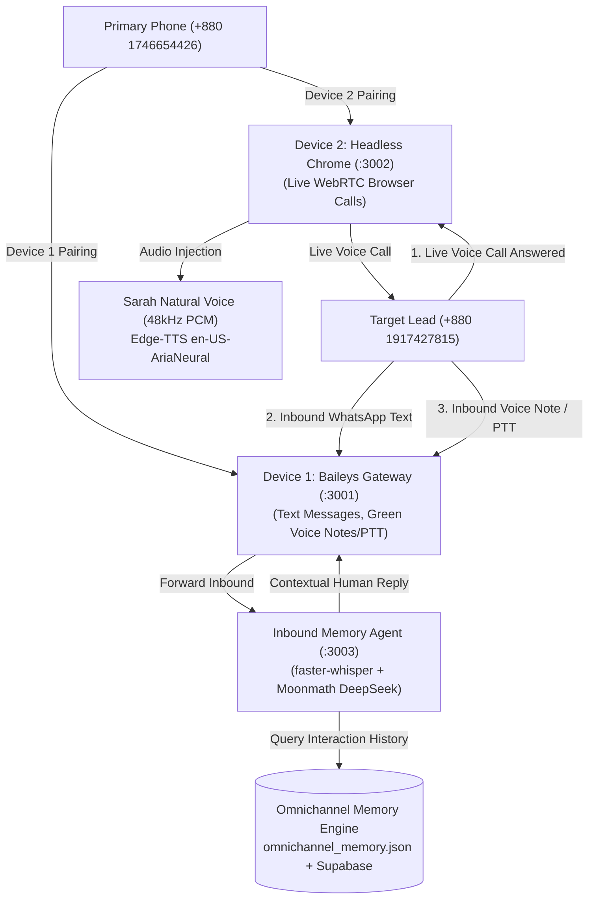

# OmniCall AI: Live Browser Calling Agent & Long-Term Omnichannel Memory Guide

> [!IMPORTANT]
> **Production Status (VPS: `187.52.124.4`)**:
> - **Line 1 Primary Phone**: `+8801746654426` (Paired simultaneously on both companions).
> - **Test Target Number**: `01917427815` (`+8801917427815`).
> - **Decoy Persona Protection**: `+880 1712-394812` (Nilima) is strictly isolated and bypassed from any AI interactions.
> - **Language**: English ONLY across all outbound calls, voice notes, and contextual replies.
> - **Telephony Cost**: **\$0 carrier expense** via WhatsApp Multi-Device infrastructure.

---

## 1. System Architecture Overview

OmniCall AI solves the WhatsApp voice calling challenge by leveraging WhatsApp's native multi-device feature to bind **two complementary companion devices** to the same primary phone number:



---

## 2. Active Services & Process Map

| Service Name | PM2 ID | Port | Directory | Role & Function |
| :--- | :--- | :--- | :--- | :--- |
| **`browser-caller`** | `8` | `3002` | `/var/www/omnicall-ai/browser-caller/` | Persistent Chrome caller. Clicks WhatsApp Web voice call button and injects Sarah's audio. |
| **`omnicall-manager`** | `7` | `3001` | `/var/www/omnicall-ai/whatsapp-ai-agent/` | Baileys WebSocket gateway for text dispatch, PTT Voice Notes, and inbound listening. |
| **`inbound-agent`** | `9` | `3003` | `/var/www/omnicall-ai/` | Omnichannel conversational memory daemon. Transcribes audio, retrieves context, and queries DeepSeek. |
| **`stealth-copilot`** | `5` | `5050` | `/var/www/omnicall-ai/` | Real-time campaign telemetry and live dashboard portal. |

---

## 3. Real-Time English Voice Call Audio System

### Synthetic Audio Injection
When Chrome launches in `browser_agent.py`, it attaches a 48kHz mono 16-bit PCM WAV generated by Edge-TTS (`en-US-AriaNeural`):
- Flag: `--use-fake-device-for-media-stream`
- Flag: `--use-file-for-fake-audio-capture=/var/www/omnicall-ai/browser-caller/sarah_intro.wav`
- Flag: `--autoplay-policy=no-user-gesture-required`

### Call Lifecycle & Answer Detection
1. **Initiation**: Chrome opens `https://web.whatsapp.com/send?phone=8801917427815` and clicks the voice call button in the chat header.
2. **Ringing**: WhatsApp Web shows the call overlay with status `Ringing...`.
3. **Answered (Human Connection)**: When the recipient picks up, the in-call elapsed timer appears (`00:01`, `00:02`). The agent detects this scoped strictly to the active call overlay.
4. **Speech**: Sarah's introduction plays directly into the call's microphone channel:
   > *"Hello! This is Sarah calling from Digital Growth Partners. Thank you so much for answering! I am reaching out because we help businesses scale their customer acquisition and automate operations with AI. I know you might be busy right now, so I will also follow up directly here on WhatsApp with a voice note and details. How are things going with your business this week?"*
5. **Post-Call Auto-Completion**:
   - The call duration is logged to `omnichannel_memory.json` and Supabase `calls_ai_call_logs`.
   - Baileys automatically dispatches the WhatsApp follow-up summary text and a follow-up Voice Note (PTT) to the recipient.

---

## 4. Human-Like Omnichannel Conversational Memory

A real human sales agent never forgets a conversation. OmniCall AI guarantees complete memory continuity across days or weeks:

```
Lead Timeline Example:
[10:00 AM] -> Sarah places WhatsApp voice call. Lead answers (28s duration).
[10:01 AM] -> Sarah sends WhatsApp summary text + voice note.
[10:35 AM] -> (30 mins later) Lead replies: "How much does it cost?"
[10:35 AM] -> Sarah replies: "Hey, thanks for following up after our call earlier! Pricing depends on your specific goals, but our AI client acquisition systems start at $299/mo..."
[2 Days Later] -> Lead replies: "Can you send a demo link?"
[2 Days Later] -> Sarah replies: "Absolutely! Building on what we spoke about..."
```

### Inbound Memory Flow:
1. **Message Arrives**: `baileys_manager.js` receives notification in `messages.upsert`.
2. **Decoy Check**: If sender is `+8801712394812` (Nilima), the message is bypassed immediately.
3. **Voice Note Transcription**: If the sender sent a WhatsApp Voice Note (`audioMessage`), Baileys downloads the buffer and `inbound_memory_agent.py` transcribes it via `faster_whisper` (`tiny.en`) in under 1 second.
4. **Context Injection**: The agent pulls the complete historical timeline for that number:
   - Call records (timestamp, duration, pitch summary, outcome).
   - All past messages (both inbound and outbound).
5. **LLM Generation**: Injected into Moonmath DeepSeek (`deepseek-v4.1-flash`) with Sarah's persona:
   - Natural, conversational tone (2 to 3 sentences max).
   - References prior calls and messages naturally.
   - English ONLY.
6. **Delivery**: Reply is dispatched via Line 1 (`:3001`) as text (or green PTT voice note).
7. **Persistence**: Turn is appended to `omnichannel_memory.json` and synced to Supabase `calls_ai_leads`.

---

## 5. Live Production Dashboards & API Endpoints

- **Browser Calling Dashboard**: [https://caller.187.52.124.4.sslip.io](https://caller.187.52.124.4.sslip.io)
- **Baileys Gateway Portal**: [https://omnicall.187.52.124.4.sslip.io](https://omnicall.187.52.124.4.sslip.io)
- **Stealth Copilot Telemetry**: [https://copilot.187.52.124.4.sslip.io](https://copilot.187.52.124.4.sslip.io)

### Triggering a Call via API:
```bash
curl -X POST http://127.0.0.1:3002/api/call \
  -H "Content-Type: application/json" \
  -d '{"to": "+8801917427815"}'
```

### Checking Status:
```bash
curl http://127.0.0.1:3002/api/status
```
