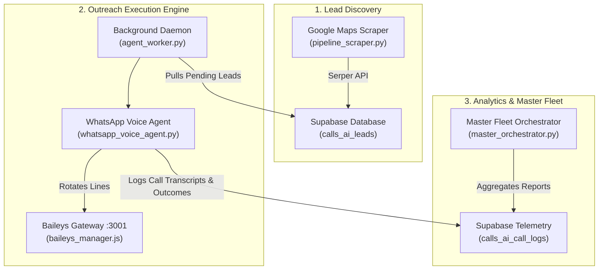

# OmniCall AI: Autonomous Calling & Omnichannel Outreach Agent Manual

> [!NOTE]
> **Status**: 🟢 **ONLINE & FULLY OPERATIONAL**  
> Line 1 (`+8801746654426`) is paired and connected via `@whiskeysockets/baileys` on PM2 `omnicall-manager`. Live outreach and WhatsApp message tests to `+8801917427815` succeeded with Supabase telemetry logging.

---

## 1. System Overview & Core Objectives

OmniCall AI (VoicePulse AI) is an autonomous, multi-agent outbound business development engine designed to replace costly carrier telephony (e.g., SignalWire/Twilio per-minute charges) with zero-cost WhatsApp VoIP calling and smart automated text follow-ups.

### Key Capabilities
* **Baileys Direct WebSocket Gateway**: High-performance headless WhatsApp connection consuming $<150$MB RAM with instantaneous 8-digit pairing code generation and zero Puppeteer overhead.
* **Serper Google Maps Lead Scraper**: Discovers local contractors and commercial targets, normalizes phone numbers to E.164, and avoids duplicate calls via Supabase checks.
* **Sarah Persona Consultation State Machine**: Outbound AI consultant pitching a free custom 24/7 AI Lead Assistant.
* **Answering Machine Detection (AMD)**: Detects voicemails within 2.0 seconds and triggers an instant hangup to avoid wasting bandwidth.
* **Smart Text Fallback**: Automatically sends an E.164-targeted WhatsApp message whenever a call goes unanswered.
* **Multi-Line Rotation**: Distributes outbound volume across phone lines with automatic cooldown tracking to prevent rate limits.
* **Supabase Omnichannel Telemetry**: Persists call logs, audio transcripts, durations, and lead pipeline states in real time.
* **Detached Background Daemon**: Operates asynchronously in the background (`agent_worker.py`) without blocking developer workflows.

---

## 2. System Architecture



---

## 3. Directory & File Inventory

All project files are synced locally at `voicepulse-ai/` and on the VPS at `/var/www/omnicall-ai/`:

| File / Component | Purpose |
| :--- | :--- |
| [pipeline_scraper.py](file:///var/www/omnicall-ai/pipeline_scraper.py) | Google Maps Places lead discovery via Serper, E.164 normalization, Supabase deduplication. |
| [whatsapp_voice_agent.py](file:///var/www/omnicall-ai/whatsapp_voice_agent.py) | Sarah persona calling state machine, AMD logic, dynamic text fallback, Supabase telemetry. |
| [agent_worker.py](file:///var/www/omnicall-ai/agent_worker.py) | Detached background daemon (`start`, `status`, `stop`) executing batch campaigns asynchronously. |
| [master_orchestrator.py](file:///var/www/omnicall-ai/master_orchestrator.py) | Multi-agent fleet manager and Supabase analytics aggregator generating Daily Executive Reports. |
| [test_outreach.py](file:///var/www/omnicall-ai/test_outreach.py) | CLI utility to trigger an instant call and message cycle to a specific test phone number. |
| [phone_lines.json](file:///var/www/omnicall-ai/phone_lines.json) | Configuration of line inventory (Line 1: `+8801746654426`). |
| [baileys_manager.js](file:///var/www/omnicall-ai/whatsapp-ai-agent/baileys_manager.js) | Lightweight Baileys pairing & REST gateway on port 3001 with 8-digit pairing code & QR support. |
| [.env](file:///var/www/omnicall-ai/.env) | Secrets: Supabase URL, Service Role Key, Serper API Key, and KIE LLM API Key. |

---

## 4. Current Operational Status

- **Line 1 WhatsApp Account**: `+8801746654426` (`user: 8801746654426:3@s.whatsapp.net`)
- **PM2 Service**: `omnicall-manager` (online on port `3001`)
- **Web Dashboard**: `https://omnicall.187.52.124.4.sslip.io` (`🟢 CONNECTED & READY`)
- **Latest Verified Test Target**: `+8801917427815`
  - WhatsApp Text Delivery: `{"ok":true,"id":"3EB0D3248D0CCC7D890841","status":"sent"}`
  - Supabase Call Record: `test_1794836204` $\rightarrow$ `video_requested` (86.3s)

---

## 5. Operations & Execution Commands

### A. Run an Outreach Test to Any Number
```bash
ssh antigravity-vps "python3 /var/www/omnicall-ai/test_outreach.py --to '+8801917427815' --name 'Hasan' --company 'Hasan Enterprise'"
```

### B. Send an Instant WhatsApp Text via REST API
```bash
ssh antigravity-vps 'curl -s -X POST http://localhost:3001/api/send-text -H "Content-Type: application/json" -d "{\"to\": \"+8801917427815\", \"text\": \"Hello from OmniCall AI Line 1!\"}"'
```

### C. Run Real Lead Scraper (Google Maps)
```bash
ssh antigravity-vps "python3 /var/www/omnicall-ai/pipeline_scraper.py --query 'Plumbers in Houston, TX' --limit 10"
```

### D. Start & Monitor Background Outbound Daemon
```bash
# Start background dialing daemon
ssh antigravity-vps "python3 /var/www/omnicall-ai/agent_worker.py start"

# Check daemon progress
ssh antigravity-vps "python3 /var/www/omnicall-ai/agent_worker.py status"

# Stop daemon when finished
ssh antigravity-vps "python3 /var/www/omnicall-ai/agent_worker.py stop"
```

### E. Run Master Multi-Agent Orchestrator
```bash
ssh antigravity-vps "python3 /var/www/omnicall-ai/master_orchestrator.py --daily-report"
```
