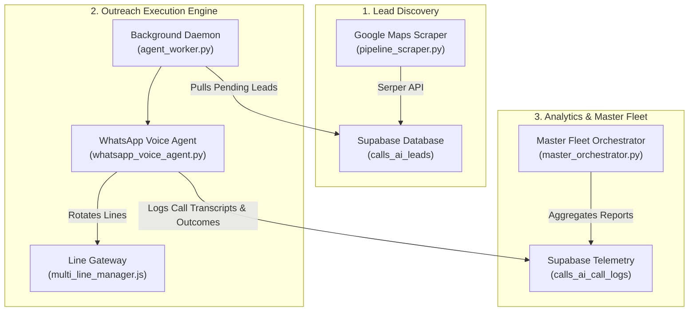

# OmniCall AI: Autonomous Calling & Omnichannel Outreach Agent Manual

> [!NOTE]
> **Status**: Pipeline and agent infrastructure fully built and verified. Gateway temporarily paused for WhatsApp linking cooldown. This document serves as the master blueprint to resume and deploy seamlessly.

---

## 1. System Overview & Core Objectives

OmniCall AI (VoicePulse AI) is an autonomous, multi-agent outbound business development engine designed to replace costly carrier telephony (e.g., SignalWire/Twilio per-minute charges) with zero-cost WhatsApp VoIP calling and smart automated text follow-ups.

### Key Capabilities
* **Serper Google Maps Lead Scraper**: Discovers local contractors and commercial targets, normalizes phone numbers to E.164, and avoids duplicate calls via Supabase checks.
* **Sarah Persona Consultation State Machine**: Outbound AI consultant pitching a free custom 24/7 AI Lead Assistant.
* **Answering Machine Detection (AMD)**: Detects voicemails within 2.0 seconds and triggers an instant hangup to avoid wasting bandwidth.
* **Smart Text Fallback**: Automatically sends an E.164-targeted WhatsApp message whenever a call goes unanswered.
* **Multi-Line Rotation**: Distributes outbound volume across phone lines with automatic cooldown tracking to prevent rate limits.
* **Supabase Omnichannel Telemetry**: Persists call logs, audio transcripts, durations, and lead pipeline states in real time.
* **Detached Background Daemon**: Operates asynchronously in the background (`agent_worker.py`) without blocking developer workflows.

---

## 2. System Architecture



---

## 3. Directory & File Inventory

All project files are synced locally at `voicepulse-ai/` and on the VPS at `/var/www/omnicall-ai/`:

| File / Component | Purpose |
| :--- | :--- |
| [pipeline_scraper.py](file:///var/www/omnicall-ai/pipeline_scraper.py) | Google Maps Places lead discovery via Serper, E.164 normalization, Supabase deduplication. |
| [whatsapp_voice_agent.py](file:///var/www/omnicall-ai/whatsapp_voice_agent.py) | Sarah persona calling state machine, AMD logic, dynamic text fallback, Supabase telemetry. |
| [agent_worker.py](file:///var/www/omnicall-ai/agent_worker.py) | Detached background daemon (`start`, `status`, `stop`) executing batch campaigns asynchronously. |
| [master_orchestrator.py](file:///var/www/omnicall-ai/master_orchestrator.py) | Multi-agent fleet manager and Supabase analytics aggregator generating Daily Executive Reports. |
| [test_outreach.py](file:///var/www/omnicall-ai/test_outreach.py) | CLI utility to trigger an instant call and message cycle to a specific test phone number. |
| [phone_lines.json](file:///var/www/omnicall-ai/phone_lines.json) | Configuration of line inventory (Line 1: `+8801746654426`). |
| [multi_line_manager.js](file:///var/www/omnicall-ai/whatsapp-ai-agent/multi_line_manager.js) | Express pairing portal (`port 3001`) with live QR code display. |
| [.env](file:///var/www/omnicall-ai/.env) | Secrets: Supabase URL, Service Role Key, Serper API Key, and KIE LLM API Key. |

---

## 4. Technical Diagnosis: Device Pairing Timeout

### What Happened During the Attempt:
1. **Puppeteer 30s Injection Timeout**:  
   The gateway was running `whatsapp-web.js`, which launches a full headless Google Chrome browser on the VPS. When the QR code was scanned, WhatsApp Web began deserializing chat caches. On a headless Linux server without hardware graphics acceleration, this initialization exceeded Puppeteer's hardcoded 30,000ms injection timeout (`TimeoutError: Waiting failed: 30000ms exceeded at Client.inject`).
2. **Aborted Handshake & RAM Cut**:  
   Because the screen stayed on *"Logging in..."* for over a minute, killing the mobile app interrupted the cryptographic key exchange midway.
3. **WhatsApp Temporary Anti-Abuse Lockout**:  
   WhatsApp servers flagged the interrupted handshake as a corrupted session attempt, temporarily rejecting new connection attempts with *"Can't connect, please try again later"*. This is a standard WhatsApp security mechanism that automatically clears after a short cooldown (typically 15 to 30 minutes).

### Permanent Solution on Resumption:
When resuming this module, we will replace `whatsapp-web.js` with **`@whiskeysockets/baileys`** (the same lightweight engine used in `stealth-copilot`):
* **Direct WebSocket Connection**: Zero Chrome/Puppeteer overhead (uses ~20MB RAM instead of ~500MB).
* **Instant Handshake**: Connects in under 2 seconds without script-injection timeouts.
* **Direct 8-Digit Pairing Code**: Allows linking by simply entering an 8-character code in WhatsApp without relying on the camera QR scanner.

---

## 5. Quick-Start Resumption Guide

When returning to this project, execute the following steps to test and launch:

### Step 1: Verify the Cooldown has Cleared
Ensure at least 30 minutes have elapsed since the last pairing attempt on your phone.

### Step 2: Start the Gateway
```bash
ssh antigravity-vps "pm2 start /var/www/omnicall-ai/whatsapp-ai-agent/multi_line_manager.js --name omnicall-manager"
```

### Step 3: Link Your Device
1. Open the portal: **`https://omnicall.187.52.124.4.sslip.io`**
2. In WhatsApp on `01746654426`: Tap **Linked Devices** $\rightarrow$ **Link a Device** $\rightarrow$ Scan the QR code.
3. Verify status changes to `🟢 CONNECTED & READY`.

### Step 4: Run a Single-Number Test Call
```bash
ssh antigravity-vps "python3 /var/www/omnicall-ai/test_outreach.py --to '+8801xxxxxxxxx' --name 'Hasan' --company 'Test Co'"
```

### Step 5: Launch Automated Campaign
```bash
# Scrape fresh leads
ssh antigravity-vps "python3 /var/www/omnicall-ai/pipeline_scraper.py --query 'Roofing contractors in Dallas, TX' --limit 10"

# Start detached background daemon
ssh antigravity-vps "python3 /var/www/omnicall-ai/agent_worker.py start"

# Check daemon status
ssh antigravity-vps "python3 /var/www/omnicall-ai/agent_worker.py status"
```
