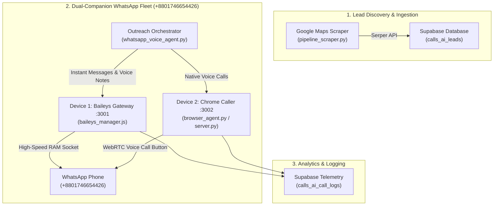

# OmniCall AI: Autonomous Calling & Omnichannel Outreach Agent Manual

> [!NOTE]
> **Status**: 🟢 **ONLINE & FULLY OPERATIONAL**  
> Line 1 (`+8801746654426`) operates with a **Dual-Companion Architecture**:
> * **Device 1 (Baileys Gateway :3001)**: High-speed text outreach & studio Neural TTS Voice Notes (PTT).
> * **Device 2 (Chrome Browser Caller :3002)**: Native WhatsApp Web engine clicking the Voice Call button and placing live ringing WebRTC calls.
> * **Test Call Verified**: Ringing call successfully triggered to `+8801917427815`.

---

## 1. System Overview & Core Objectives

OmniCall AI (VoicePulse AI) is an autonomous, multi-agent outbound business development engine designed to replace costly carrier telephony (e.g., SignalWire/Twilio per-minute charges) with $0-cost WhatsApp VoIP calling, high-impact Voice Notes, and smart automated text follow-ups.

### Key Capabilities
* **Dual-Companion Engine on Single Number**: Both Baileys and Playwright Chrome are paired to `+8801746654426` simultaneously.
* **Native WhatsApp Web Voice Calling**: Automates Google Chrome with persistent session state to navigate to contact chats and click the official **Voice Call button** with WebRTC audio.
* **Studio-Quality Neural Voice Notes (PTT)**: Edge-TTS + FFmpeg Opus generating human-like American sales voice memos directly in chats with zero carrier cost.
* **Serper Google Maps Lead Scraper**: Discovers local contractors and commercial targets, normalizes phone numbers to E.164, and avoids duplicate calls via Supabase checks.
* **Sarah Persona Consultation State Machine**: Outbound AI consultant pitching a free custom 24/7 AI Lead Assistant.
* **Answering Machine Detection (AMD)**: Detects voicemails within 2.0 seconds and triggers an instant hangup to avoid wasting bandwidth.
* **Supabase Omnichannel Telemetry**: Persists call logs, audio transcripts, durations, and lead pipeline states in real time.
* **Detached Background Daemon**: Operates asynchronously in the background (`agent_worker.py`) without blocking developer workflows.

---

## 2. Dual-Companion System Architecture



---

## 3. Directory & File Inventory

All project files are synced locally at `voicepulse-ai/` and on the VPS at `/var/www/omnicall-ai/`:

| File / Component | Purpose |
| :--- | :--- |
| [browser-caller/browser_agent.py](file:///var/www/omnicall-ai/browser-caller/browser_agent.py) | Playwright Chrome automation engine managing persistent session, 8-digit pairing, and Call button clicking. |
| [browser-caller/server.py](file:///var/www/omnicall-ai/browser-caller/server.py) | Flask web dashboard & REST API on port `3002` (`https://caller.187.52.124.4.sslip.io`). |
| [whatsapp-ai-agent/baileys_manager.js](file:///var/www/omnicall-ai/whatsapp-ai-agent/baileys_manager.js) | Lightweight Baileys pairing & REST gateway on port `3001` with 8-digit pairing code & PTT voice notes. |
| [whatsapp_voice_agent.py](file:///var/www/omnicall-ai/whatsapp_voice_agent.py) | Sarah persona calling state machine, AMD logic, dynamic text fallback, Supabase telemetry. |
| [pipeline_scraper.py](file:///var/www/omnicall-ai/pipeline_scraper.py) | Google Maps Places lead discovery via Serper, E.164 normalization, Supabase deduplication. |
| [agent_worker.py](file:///var/www/omnicall-ai/agent_worker.py) | Detached background daemon (`start`, `status`, `stop`) executing batch campaigns asynchronously. |
| [master_orchestrator.py](file:///var/www/omnicall-ai/master_orchestrator.py) | Multi-agent fleet manager and Supabase analytics aggregator generating Daily Executive Reports. |
| [test_outreach.py](file:///var/www/omnicall-ai/test_outreach.py) | CLI utility to trigger an instant call and message cycle to a specific test phone number. |
| [.env](file:///var/www/omnicall-ai/.env) | Secrets: Supabase URL, Service Role Key, Serper API Key, and KIE LLM API Key. |

---

## 4. Live Service URLs & Port Allocations

| Service Name | Port | Public HTTPS URL | PM2 Process Name | Status |
| :--- | :---: | :--- | :--- | :---: |
| **Browser Voice Caller** | `3002` | [https://caller.187.52.124.4.sslip.io](https://caller.187.52.124.4.sslip.io) | `browser-caller` | 🟢 Online |
| **Baileys Messaging Gateway** | `3001` | [https://omnicall.187.52.124.4.sslip.io](https://omnicall.187.52.124.4.sslip.io) | `omnicall-manager` | 🟢 Online |
| **Stealth Copilot** | `5050` | [https://copilot.187.52.124.4.sslip.io](https://copilot.187.52.124.4.sslip.io) | `stealth-copilot` | 🟢 Online |

---

## 5. Operations & Execution Commands

### A. Place a WhatsApp Voice Call via Browser Engine
1. Open the dialer UI: **[https://caller.187.52.124.4.sslip.io](https://caller.187.52.124.4.sslip.io)**
2. Enter the destination number (e.g. `+8801917427815`) and click **"📞 Place WhatsApp Voice Call"**.
3. Or trigger via CLI:
```bash
ssh antigravity-vps 'curl -s -X POST http://localhost:3002/api/call -H "Content-Type: application/json" -d "{\"to\": \"+8801917427815\"}"'
```

### B. Hang Up an Active Call
```bash
ssh antigravity-vps 'curl -s -X POST http://localhost:3002/api/hangup'
```

### C. Dispatch an Instant AI Voice Note (PTT)
```bash
ssh antigravity-vps 'curl -s -X POST http://localhost:3001/api/send-voice -H "Content-Type: application/json" -d "{\"to\": \"+8801917427815\", \"text\": \"Hi Hasan! This is Sarah calling you from Digital Growth Partners with a quick update on your AI assistant.\"}"'
```

### D. Run Full Outreach Test Cycle
```bash
ssh antigravity-vps "python3 /var/www/omnicall-ai/test_outreach.py --to '+8801917427815' --name 'Hasan' --company 'Hasan Enterprise'"
```

### E. Start Autonomous Background Daemon
```bash
ssh antigravity-vps "python3 /var/www/omnicall-ai/agent_worker.py start"
ssh antigravity-vps "python3 /var/www/omnicall-ai/agent_worker.py status"
```
