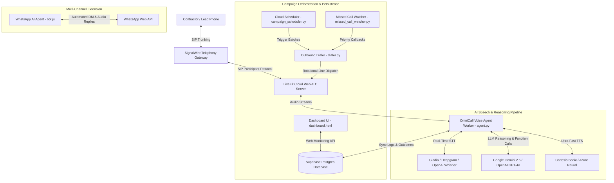

# OmniCall AI 🎙️⚡
### Enterprise Multi-Channel Voice AI Agent & Outbound Telephony Automation System

[](https://www.python.org/downloads/)
[](https://livekit.io/)
[](https://signalwire.com/)
[](https://supabase.com/)
[](https://www.docker.com/)

**OmniCall AI** is a production-ready, autonomous Voice & Messaging Conversational AI platform engineered for high-volume outbound telephony campaigns, automated 24/7 inbound callback handling, and multi-channel messaging (WhatsApp / Web Chat). 

Built on top of **LiveKit Real-Time WebRTC/SIP**, **SignalWire Telephony**, **Google Gemini / OpenAI LLMs**, **Cartesia / Azure Neural TTS**, and **Deepgram / Gladia Real-Time STT**, the system enables human-like, ultra-low-latency voice conversations with real-time state management, Answering Machine Detection (AMD), and dynamic API key resilience.

---

## 🏗️ System Architecture



---

## ✨ Key Features & Technical Highlights

### 1. 🎙️ Autonomous Conversational Voice AI (`agent.py`)
- **Ultra-Low Latency**: Sub-second end-to-end voice latency powered by LiveKit Agents WebRTC pipeline.
- **Dynamic Prompt State Machine**: State-aware dialogue flow handling warm openers, value proposition pitching, objection handling, meeting scheduling, and structured data extraction.
- **Resilient API Key Rotation**: Automatic health-checking and key-rotation layer across Gladia STT and Cartesia TTS providers (`api_keys.py`).
- **Answering Machine Detection (AMD)**: Instant 1–2 second detection of voicemail machines and greetings with auto-hangup to eliminate unnecessary carrier minute charges.

### 2. 📞 Multi-Line Outbound SIP Dialer (`dialer.py`)
- **Rotational Line Management**: Distributes outbound calls dynamically across multiple SignalWire SIP trunks (`phone_lines.py`) with line-level cooldown timers and self-call prevention.
- **Batch Rate Control**: Configurable concurrency and `--limit` flags to enforce windowed campaign execution and prevent carrier flagging.
- **Single-Threaded Safety**: Safe task queuing that eliminates concurrency race conditions on line state.

### 3. ⚡ 24/7 Cloud Campaign Scheduler (`campaign_scheduler.py`)
- **Timezone-Aware Dispatching**: Multi-timezone matching engine supporting UTC, Dhaka (UTC+6), EST, and CST campaign windowing.
- **Supabase Polling Engine**: Polls database tables (`calls_ai_campaign_schedules`) every 10 seconds for automated campaign dispatching.

### 4. 🔄 Real-Time Missed Call & Priority Callback Watcher (`missed_call_watcher.py`)
- **Instant Inbound Interception**: Intercepts missed inbound calls and automatically queues priority AI callbacks when lines become available.

### 5. 🗄️ Supabase Lead Pipeline & Transcript Persistence (`supabase_db.py`, `call_history.py`)
- **3-Tier Outcome Grouping**: Automatically categorizes leads into `group1_humans` (live pickups), `group2_voicemails` (AMD hangups), and `group3_unanswered`.
- **Full Conversation Logging**: Persists entire turn-by-turn conversation JSON transcripts, audio duration, and outcomes into Supabase PostgreSQL.
- **Lead Context Memory**: Remembers prior conversation turns across multi-touch callbacks to maintain context continuity.

### 6. 💬 WhatsApp Multi-Channel AI Assistant (`whatsapp-ai-agent/`)
- **Node.js Bot Integration**: Automated WhatsApp messaging bot (`bot.js`) that handles text queries and audio messages, linking voice outreach with social messaging channels.

### 7. 📊 Web Monitoring Dashboard (`dashboard.html`)
- **Built-in HTTP Server**: Embedded dashboard web server running on port `8080` displaying real-time campaign stats, lead groups, schedule controls, and CSV export endpoints.

---

## 📁 Repository Structure

```
.
├── agent.py                      # Primary LiveKit Voice AI Agent (Worker Entrypoint)
├── dialer.py                     # Outbound Multi-Line SIP Dialer & Campaign Manager
├── campaign_scheduler.py         # 24/7 Cloud Campaign Scheduler & Supabase Poller
├── missed_call_watcher.py        # Real-Time Missed Call Auto-Callback Engine
├── supabase_db.py                # Supabase PostgreSQL Integration Client
├── call_logger.py                # Call Logging & Group Categorization Engine
├── call_history.py               # Lead Memory Context & Transcript Extractor
├── call_queue.py                 # Priority Callback & Retry Queue Management
├── phone_lines.py                # Line Rotation, Cooldown, & Trunk Manager
├── api_keys.py                   # Provider API Key Rotation & Health Check Engine
├── availability.py               # Dynamic Appointment Slot & Availability Engine
├── dashboard.html                # Real-Time Monitoring Dashboard Frontend
├── Dockerfile                    # Containerization Setup for Cloud Deployments
├── Procfile                      # Process Manager Entrypoint (Railway / Heroku)
├── requirements.txt              # Python Dependencies
├── start_services.sh             # Multi-Process Startup Daemon Script
├── supabase_schema.sql           # Database Schema (Tables, Indexes, & Policies)
├── insert_texas_roofers.sql      # Seed Data SQL Script
├── roofers.csv                   # Sample Lead Dataset (CSV format)
└── whatsapp-ai-agent/            # WhatsApp Multi-Channel AI Assistant Module
    ├── package.json              # Node.js Dependencies
    ├── Dockerfile                 # WhatsApp Agent Container Setup
    └── src/
        ├── bot.js                # WhatsApp Web Client Bot Logic
        └── ai_engine.js          # WhatsApp AI Response Engine
```

---

## 🛠️ Tech Stack

- **Languages**: Python 3.11+, JavaScript (Node.js ES6+)
- **Real-Time Voice Architecture**: LiveKit Voice Agents SDK, LiveKit SIP Server
- **Telephony Provider**: SignalWire Outbound & Inbound SIP Trunking
- **AI / LLM Frameworks**: Google Gemini 2.5 Flash, OpenAI GPT-4o / OpenRouter
- **Speech Synthesis (TTS)**: Cartesia Sonic Fast Voice, Microsoft Azure Neural TTS
- **Speech Recognition (STT)**: Gladia Real-Time STT, Deepgram Nova-2, OpenAI Whisper
- **Database & Backend**: Supabase (PostgreSQL), REST APIs
- **Web UI & Dashboard**: HTML5, Vanilla CSS3, JavaScript (Fetch API), aiohttp
- **Deployment & DevOps**: Docker, Railway Cloud Infrastructure

---

## 🚀 Quick Start Guide

### 1. Prerequisites
- Python 3.11 or higher
- Node.js 18+ (for WhatsApp Agent)
- LiveKit Cloud Account & Credentials (`LIVEKIT_URL`, `API_KEY`, `API_SECRET`)
- SignalWire SIP Trunk Setup
- Supabase Project & API Key

### 2. Environment Setup
Clone the repository and create a `.env` file in the root directory:

```bash
git clone https://github.com/12345Shahid/calls-r.git
cd calls-r

# Create python virtual environment
python3 -m venv .venv
source .venv/bin/activate
pip install -r requirements.txt
```

Example `.env` configuration:

```env
# LiveKit Credentials
LIVEKIT_URL=wss://your-livekit-domain.livekit.cloud
LIVEKIT_API_KEY=your_livekit_api_key
LIVEKIT_API_SECRET=your_livekit_api_secret
LIVEKIT_SIP_TRUNK_ID=ST_your_sip_trunk_id

# AI Models & Speech APIs
LLM_PROVIDER=google
LLM_MODEL=gemini-2.5-flash
GEMINI_API_KEY=your_gemini_api_key
OPENAI_API_KEY=your_openai_api_key
GLADIA_API_KEY=your_gladia_api_key
CARTESIA_API_KEY=your_cartesia_api_key

# Supabase Persistence
SUPABASE_URL=https://your-project.supabase.co
SUPABASE_KEY=your_supabase_anon_key

# Server Port
PORT=8080
```

### 3. Database Initialization
Run the schema in your Supabase SQL Editor:
1. Apply `supabase_schema.sql` to create all required tables (`calls_ai_leads`, `calls_ai_call_logs`, `calls_ai_campaign_schedules`).
2. (Optional) Run `insert_texas_roofers.sql` to populate sample lead records.

### 4. Running the System

#### A. Start the Voice AI Agent (Worker):
```bash
python agent.py dev
```
*The agent worker will connect to LiveKit and host the Monitoring Dashboard at `http://localhost:8080/dashboard`.*

#### B. Launch an Outbound Campaign:
```bash
# Dial leads directly from Supabase database:
python dialer.py --csv supabase_leads --auto-queue

# Dial with a batch limit of 12 leads:
python dialer.py --csv supabase_leads --auto-queue --limit 12
```

#### C. Start 24/7 Cloud Campaign Scheduler:
```bash
python campaign_scheduler.py
```

#### D. Start WhatsApp AI Assistant:
```bash
cd whatsapp-ai-agent
npm install
npm start
```

---

## 🐳 Docker & Cloud Deployment

The repository includes pre-configured Dockerfiles for seamless deployment on **Railway**, **Render**, or **AWS ECS**.

To build and run via Docker locally:

```bash
docker build -t omnicall-ai .
docker run -p 8080:8080 --env-file .env omnicall-ai
```

---

## 📜 License & Acknowledgments

Developed by **Shahid Hasan** as an enterprise-grade AI Telephony & Multi-Channel Sales Automation solution. Distributed under the MIT License.
