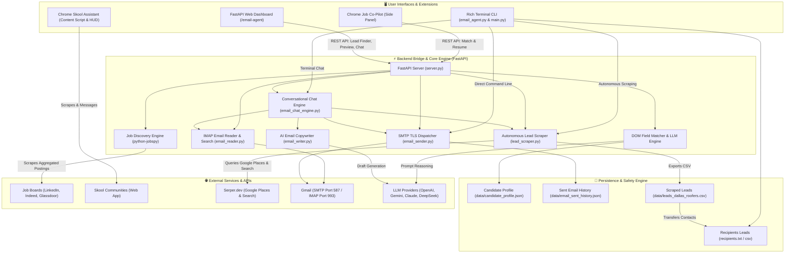

# ⚡ Automation Tools Suite
### Production-Grade AI Browser Agents, Lead Scrapers & Autonomous Outreach Copilots

[](https://www.python.org/)
[](https://fastapi.tiangolo.com)
[](https://developer.chrome.com/docs/extensions/mv3/intro/)
[](https://serper.dev/)
[](https://support.google.com/mail/answer/7126229)
[](https://opensource.org/licenses/MIT)

A unified monorepo of production-ready automation engines designed for high-scale workflows, autonomous web lead generation, client outreach, and job market acceleration. Built with Python, FastAPI, Chrome Extensions (Manifest V3), Serper Google Places, and zero-credit fallback AI copywriters.

---

## 🏛️ System Architecture



---

## 📦 The 4 Core Automation Systems

### 1. 🎯 Autonomous Web Lead Scraper & Contact Enricher (Serper.dev)
An intelligent Google Places & Search automation pipeline built to source high-ticket clients and export structured datasets directly to CSV.

* **"No Website" Local Business Discovery**: Specifically isolates high-revenue local businesses (e.g. *Roofing Contractors in Dallas, TX*) that have active Google Business Profiles with phone numbers, reviews, and addresses, but **no website listed**.
* **Zero Bot-Bans / Anti-CAPTCHA**: Built on top of Serper.dev to query Google Places through residential infrastructure without ever getting blocked.
* **Deep Contact & Email Enrichment**: Automatically queries Google search, public directories, and social profile footprints (`facebook.com`, Yelp, BBB) to extract public verified emails (`@gmail.com`, `@yahoo.com`, domain emails).
* **B2B IT Agency Subcontracting Finder**: Discovers IT & software development agencies, crawling their websites for public contact emails (`contact@...`, `info@...`) to pitch independent contractor services.
* **1-Click Pipeline Transfer**: Discovered leads and emails can be pushed directly into the automated email outreach campaign with one click or CLI flag.

---

### 2. 📬 Autonomous Cold Email Outreach & Inbox Copilot
A conversational outbound email engine with Gmail SMTP TLS dispatch, IMAP SSL inbox reader, keyword search, and an interactive 4-in-1 Web Dashboard.

* **Conversational Chat Dispatching**: Chat in natural English (e.g. *"Find 10 roofers from Dallas who don't have a website and fill up their contact details into CSV"* or *"Email alex@acme.com and tell him I can build a website for \$1"*).
* **High-Converting Offer Pitch Templates**:
  - **Local Contractors**: *"I noticed {company} has a solid local reputation in Dallas, but no website. I built a free mobile demo website for you — let's hop on a 10-minute call so I can show it to you."*
  - **IT Agencies**: *"Independent senior full-stack developer offering reliable subcontracting capacity at competitive contractor rates for your client overflow."*
  - **Startup Review Offer**: Custom website build for \$1 in exchange for a portfolio testimonial.
* **Gmail IMAP SSL Inbox Reader**: Reads incoming emails, parses RFC 2047 headers, decodes multipart content, and generates executive summaries.
* **Anti-Spam & Duplicate Shield**: Maintains persistent history in `data/email_sent_history.json` to guarantee you never email the same contact twice. Automatically introduces randomized pauses (8–15s) between batch dispatches.
* **Zero-Credit Fallback Architecture**: Runs 100% reliably with or without LLM API balances.

---

### 3. 💼 AI Job Application Co-Pilot & Autofill Extension
A Chrome Side Panel extension (Manifest V3) that searches job aggregators and automatically autofills complex job application forms (LinkedIn Easy Apply, Greenhouse, Lever, Workday, and custom career portals).

* **Zero-Token Instant DOM Parsing**: Extracts form fields in milliseconds directly within Chrome JavaScript without paying for expensive vision models or screenshot processing.
* **Micro-Cost LLM Field Matching**: Maps detected inputs (text fields, radio groups, date pickers, dropdown selects) to your candidate profile for less than **\$0.0001 per application**.
* **Automated Resume Upload Simulation**: Automatically attaches your PDF resume from the local backend bridge.
* **Pause Before Submit**: Outlines all autofilled fields in green and pauses before the final submission button so you always remain in full control.
* **Instant Multi-Board Job Discovery**: Scrapes and aggregates LinkedIn, Indeed, and Glassdoor in under 3 seconds using `python-jobspy`.

---

### 4. 🎓 Skool Community Automated Outreach Assistant
A dedicated Chrome Extension designed for ethical, automated lead generation and member outreach inside Skool communities.

* **Smart Member Directory Scraper**: Automatically identifies member cards, profile links, names, and handles from community `/members` pages.
* **Admin Shield (Anti-Ban Protection)**: Detects and automatically skips Community Creators, Admins, Moderators, and Staff to safeguard your account against bans.
* **Nested Spintax Engine**: Supports syntax like `{Hey|Hi|Hello} {first_name}! {Hope you are well|Hope you're having a productive week}` ensuring every outgoing direct message has a unique text hash.
* **Human Typing Simulation & Randomized Jitter**: Simulates human keystrokes with randomized delay intervals (45–90s) between messages.
* **In-Page Floating HUD**: Real-time on-screen countdown timer, queue counter, and 1-click `[Pause]`, `[Resume]`, and `[Stop]` controls.

---

## 📂 Repository Structure

```
Automation-Tools/
├── .env.example                # Clean environment variables template (SMTP, IMAP, Serper, LLMs)
├── .gitignore                  # Security-first ignore rules (strictly excludes .env and private history)
├── pyproject.toml              # Modern Python packaging configuration (uv/pip)
├── requirements.txt            # Traditional pip dependency manifest
├── main.py                     # Unified interactive CLI launcher
├── server.py                   # FastAPI bridge backend & REST endpoints
├── email_agent.py              # CLI runner for email campaigns, lead scraping & chat copilot
├── cli.py                      # CLI tool for job discovery & Chrome debugging
│
├── extension/                  # Chrome Extension 1: Job Co-Pilot
│   ├── manifest.json           # Manifest V3 configuration (sidePanel, storage)
│   ├── background.js           # Extension lifecycle & side panel worker
│   ├── content.js              # DOM scanner & synthetic event injector
│   ├── content.css             # In-page element highlight styling
│   ├── sidepanel/              # Side panel interface (Discovery, Apply, Profile)
│   └── test_job_form.html      # Local mock job form for offline testing
│
├── skool-agent/                # Chrome Extension 2: Skool Outreach Assistant
│   ├── manifest.json           # Manifest V3 configuration
│   ├── background.js           # Campaign state manager & deduplication store
│   ├── content.js              # Member list scraper, typing simulator & Floating HUD
│   ├── popup/                  # Extension popup controller & Spintax editor
│   └── test_skool_community.html # Local mock Skool community for offline testing
│
├── src/                        # Core Python Engine & Logic
│   ├── lead_scraper.py         # Serper Google Places scraper & email contact enricher
│   ├── email_chat_engine.py    # Conversational intent parser & natural language router
│   ├── email_reader.py         # IMAP SSL client (inbox fetching, search, summaries)
│   ├── email_sender.py         # SMTP TLS client with multipart MIME & rate limiting
│   ├── email_writer.py         # AI outreach copywriter with zero-credit fallbacks
│   ├── discovery.py            # JobSpy multi-board job aggregator
│   ├── applier.py              # Background browser automation engine
│   ├── browser_bridge.py       # Chrome DevTools Protocol remote debugging bridge
│   └── config.py               # Multi-provider LLM factory & candidate profile loader
│
├── static/                     # Web Dashboard Assets
│   └── email_agent.html        # Single-Page Web Dashboard (Chat, Lead Finder, Bulk, Inbox)
│
├── data/                       # Local Data & Templates
│   ├── leads_dallas_roofers.csv # Sample extracted leads dataset with phones & emails
│   ├── candidate_profile.json  # Candidate details for job autofill
│   └── resumes/
│       └── sample_resume.pdf   # PDF resume for auto-upload
│
├── recipients.txt              # Text template for email leads
└── recipients.csv              # CSV template for structured leads with notes
```

---

## ⚡ Quick Start & Installation

### 1. Clone the Repository
```bash
git clone https://github.com/12345Shahid/Automation-Tools.git
cd Automation-Tools
```

### 2. Set Up Virtual Environment & Dependencies

Using [`uv`](https://github.com/astral-sh/uv) (Recommended):
```bash
uv venv
source .venv/bin/activate
uv sync
```

Or using standard `pip`:
```bash
python3 -m venv .venv
source .venv/bin/activate
pip install -r requirements.txt
```

### 3. Configure Environment Variables
Copy the template and fill in your credentials:
```bash
cp .env.example .env
```
Key settings:
* **Serper API Key**: Get a free API key at [serper.dev](https://serper.dev/) (2,500 free searches) and set `SERPER_API_KEY`.
* **Gmail App Password**: Create a 16-character password at [Google App Passwords](https://myaccount.google.com/apppasswords) and set `SMTP_PASSWORD` & `SMTP_USER`.

---

## 🚀 Usage Guide

### 1. Autonomous Lead Scraping (CLI)
```bash
# Scrape 10 Dallas roofers without a website and export to CSV
python email_agent.py --scrape --industry "roofing contractors" --location "Dallas, TX" --count 10 --export "data/leads_dallas_roofers.csv"

# Scrape 10 IT consulting agencies in Dallas
python email_agent.py --scrape --industry "IT consulting software agency" --location "Dallas, TX" --count 10 --no-website False
```

### 2. Conversational Terminal Copilot (Chat)
```bash
python email_agent.py --chat
```
Try natural queries:
* *"Find 10 roofers from Dallas who don't have a website and fill up their contact details into CSV"*
* *"Find 10 IT companies in Dallas for contracting"*
* *"Check my last 5 emails"*
* *"Email alex@acme.com and tell him I can build a website for $1"*

### 3. Web Dashboard (Chat, Lead Finder, Bulk Outreach & Inbox)
```bash
python -m uvicorn server:app --port 8000 --reload
```
Open **[http://127.0.0.1:8000/email-agent](http://127.0.0.1:8000/email-agent)**:
* **Tab 1: 💬 AI Chat Copilot** — Chat in natural English to scrape leads, draft, and dispatch emails.
* **Tab 2: 🎯 Lead Finder** — Visual interface to scrape Google Places, filter by "No Website", and 1-click transfer to outreach.
* **Tab 3: 👥 Bulk Campaign** — Paste target leads and dispatch in batches with safe delays.
* **Tab 4: 📬 Inbox & Search** — Search incoming Gmail messages by sender, subject, or body text.

---

## 🛡️ Security, Privacy & Ethics

* **Zero Credential Exposure**: `.env` and personal run histories (`data/email_sent_history.json`) are strictly gitignored.
* **Standard RFC Headers**: Emails are sent with appropriate RFC 2047 encoding, unique Message-IDs, and multipart alternative formatting.
* **Rate-Limiting & Jitter**: All outreach tools implement randomized delays to simulate natural human behavior and comply with platform limits.
* **Admin Shields**: Automated safeguards skip community leaders, staff, and previously messaged contacts to maintain community trust.

---

## 📄 License

This project is licensed under the MIT License — see the [LICENSE](LICENSE) file for details.

## 👤 Author

**Shahid Hasan**
* GitHub: [@12345Shahid](https://github.com/12345Shahid)
* Email: [shahidhasanpollob@gmail.com](mailto:shahidhasanpollob@gmail.com)
